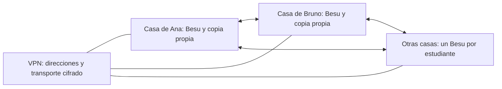

# Una blockchain entre las computadoras del curso

Esta modalidad utiliza **Besu**, un cliente real compatible con la máquina virtual de Ethereum. Cada estudiante ejecuta un nodo con Docker, conserva su propia base de datos y participa en la creación y validación de bloques. Las operaciones llevan firmas y tienen recibos reales. La moneda pertenece únicamente a esta red privada y no tiene valor fuera de ella.

El consenso se llama **QBFT**. Es un protocolo de prueba de autoridad, o PoA: el grupo inicial acuerda qué identidades pueden validar. Es distinto de la prueba de participación, o PoS, de Ethereum público. Aquí no hay depósitos de 32 ETH ni selección ponderada por stake. Los clientes realizan automáticamente las propuestas, comprobaciones, firmas y cambios de ronda. Cada estudiante administra el programa que ejerce esos deberes.

La preparación admite **de 4 a 60 validadores**. Con diez estudiantes se usan diez. Cuatro es el mínimo de esta práctica para experimentar tolerancia a fallas bizantinas. El límite superior es de configuración y no una medición de rendimiento. Para menos de cuatro estudiantes se pueden operar varios nodos por equipo o usar la simulación didáctica, aclarando cuántos operadores independientes hay.

**Estado al 29/10/2026:** se comprobaron la preparación, las firmas, la configuración y los cálculos de las herramientas. También se ejecutaron cuatro clientes Besu con una transferencia, pérdida de quórum y recuperación. La conexión entre casas y los equipos físicos del curso siguen pendientes de comprobación. La [evidencia de cuatro clientes](evidencia/cuatro-clientes.json) registra esa ejecución. La [aceptación de la práctica](ACEPTACION.md) define qué evidencia falta antes de declararla lista para la cursada.

## Las tres opciones del curso

| Modalidad | Qué ejecuta cada estudiante | Para qué sirve |
|---|---|---|
| [Simulación coordinada](../README.md) | Navegador. Una computadora tiene Node.js. | Hacer manualmente las propuestas y los votos y comprender cada paso. |
| [Simulación entre pares en una LAN](../NODOS-INDEPENDIENTES.md) | Un programa Node.js y un navegador por computadora. | Experimentar copias independientes y continuidad sin distribuidor central. |
| Red real de este tutorial, desde casa o en el laboratorio | Un Besu en Docker y Node.js 24 para preparar y consultar. | Operar clientes reales, observar consenso automático, gas, caída y recuperación. |

La [VPN también permite ejecutar la simulación desde casa](../DESDE-CASA.md). Elegir Internet como transporte no cambia por sí solo un simulador en un cliente real.

## Recursos y conexión

Se toma como supuesto una computadora con **8 GB de RAM**, Docker con contenedores Linux, Node.js 24 LTS y conexión estable. El contenedor se configura con hasta 3 GB de memoria y una memoria Java máxima de 1,5 GB. Reservar alrededor de 4 GB para la máquina virtual de Docker y al menos 10 GB de disco para el ensayo breve es un presupuesto inicial. En el ensayo breve de cuatro clientes se midieron entre 699,6 y 717,8 MiB por contenedor, con memoria Java máxima de 768 MiB. No es una medición de la carga de una clase completa ni de cada equipo de 8 GB. Cerrar aplicaciones pesadas y comprobar consumo con `docker stats`. No es una recomendación para mantener Ethereum público.

En Windows se requiere Docker Desktop usando contenedores Linux, normalmente con WSL 2. Besu no se ejecuta como un contenedor nativo de Windows. La imagen fijada es `hyperledger/besu:26.10.2`, publicada para Linux AMD64 y ARM64. La primera descarga y el alta de la VPN necesitan Internet. La biblioteca de firmas ya está en esta carpeta y no se instala con npm.

Cada casa tiene su router y puede tener una dirección pública compartida. Usamos la red privada virtual NetBird del [tutorial de conectividad](../DESDE-CASA.md), con una clave de alta individual por computadora. Para **Besu**, el grupo del curso debe permitir **TCP y UDP 30303** entre sus equipos. La simulación usa TCP 4781 y esa regla por sí sola no conecta Besu. En este ensayo los pares están predefinidos y el descubrimiento UDP está desactivado. El intercambio de bloques utiliza TCP.

El RPC es la interfaz para consultar y enviar operaciones al nodo. Se publica **solo en `127.0.0.1:8545`**, para la computadora de su propietario. Los compañeros se conectan mediante el protocolo P2P, que significa comunicación entre pares. No hay que abrir puertos en los routers domésticos ni publicar RPC en Internet.



La VPN puede usar retransmisores cifrados cuando una conexión directa no es posible. El proveedor administra conectividad y puede afectar disponibilidad. No decide qué bloque es válido ni firma como validador. Todos los nodos conocen a los demás y no dependen de un único nodo inicial para intercambiar la cadena.

## 1. Cada estudiante crea su identidad

Todos los comandos siguientes se ejecutan desde `laboratorio/ejemplos/red-aula`. Primero comprobar:

```sh
node --version
docker version
docker compose version
```

Node debe indicar 24 o posterior y Docker debe mostrar también la información del servidor. En NetBird, anotar la dirección virtual asignada. **Las direcciones 100.80.1.11 y 100.80.1.12 de abajo son ejemplos**, hay que reemplazarlas por las propias.

Ana, estudiante 1:

```sh
npm run real:preparar -- identidad --id 1 --nombre Ana --ip 100.80.1.11 --datos datos-besu-1
```

Bruno, estudiante 2, desde su computadora:

```sh
npm run real:preparar -- identidad --id 2 --nombre Bruno --ip 100.80.1.12 --datos datos-besu-2
```

Los demás usan números consecutivos hasta N y su dirección virtual. Todos pueden usar los mismos puertos porque están en computadoras diferentes. La carpeta debe ser nueva. Si ya existe, el programa se detiene para conservar sus claves y su historial.

Cada carpeta contiene:

| Archivo | Qué significa | Se comparte |
|---|---|---|
| `invitacion.json` | Nombre, dirección, clave pública del nodo, wallet pública y firmas. | Sí, este archivo únicamente. |
| `clave-nodo` | Clave privada que Besu usa para su identidad y deberes QBFT. | No. |
| `wallet-privada.json` | Otra clave privada para enviar transferencias del ensayo. | No. |

La clave del nodo y la wallet cumplen funciones diferentes. La carpeta se crea con acceso restringido y la wallet con permisos de propietario. El archivo de clave del nodo permite lectura al contenedor mediante un montaje de archivo, dentro de esa carpeta restringida. Los datos están excluidos de Git. No incluir la carpeta completa en una entrega ni en una captura.

## 2. Reunir las invitaciones públicas una sola vez

El docente u otro participante reúne los N archivos públicos en una carpeta `invitaciones-besu`. Puede renombrarlos `01.json`, `02.json`, etc. No se reúnen las claves privadas.

```sh
npm run real:preparar -- red --invitaciones invitaciones-besu --red red-besu.json --titulo "Blockchain curso 2026"
```

N surge de los archivos válidos que se recibieron. El programa rechaza firmas alteradas, destinos repetidos e identidades duplicadas. El resultado incluye una huella digital. Compartir **el mismo `red-besu.json`** con todos, junto con esa huella por un medio conocido. Las firmas vinculan cada invitación a sus claves, mientras que la lista de nombres y la huella se contrastan con el grupo real del curso.

Las firmas de una invitación no significan que el estudiante haya aceptado automáticamente cualquier grupo en el que alguien la incluya. Antes de iniciar, todos revisan los integrantes y acuerdan el mismo archivo. Quien lo reúne no recibe un privilegio permanente de consenso.

La configuración inicial utiliza bloques separados por al menos diez segundos y límite de **63.000 gas**, para observar hasta tres transferencias simples de 21.000 gas. Es un límite de nuestro ensayo. No describe el límite público de Ethereum.

Para otro curso no se modifica código. Se reúnen sus invitaciones y, si hace falta, se eligen otros parámetros al crear **una red nueva**:

```sh
npm run real:preparar -- red --invitaciones invitaciones-besu --red red-otro-curso.json --titulo "Otro curso" --chain-id 20261030 --segundos 10 --gas-limite 3000000
```

El límite más grande permite otras operaciones, como despliegues, cuyo gas debe estimarse. El recorrido de este tutorial utiliza transferencias simples. No se debe desplegar el Contador con el límite de 63.000 gas. Cambiar participantes, génesis o reglas no se resuelve editando una cadena que ya está funcionando. Para el ensayo se conserva la carpeta anterior y se prepara otra sesión.

## 3. Preparar mi nodo e iniciar Besu

Ana guarda el archivo común y ejecuta:

```sh
npm run real:preparar -- configurar --datos datos-besu-1 --red red-besu.json
docker compose -f datos-besu-1/compose.yaml config --quiet
docker compose -f datos-besu-1/compose.yaml up -d
```

Bruno usa `datos-besu-2`, y así cada uno. Se generan el mismo génesis para todos y una lista de pares que excluye al propio nodo. El montaje de datos usa un volumen persistente. La imagen contiene Besu y Java, no hay que instalar Java en la computadora.

El programa muestra la huella del archivo común y el SHA-256 del archivo de génesis. **Ambos deben coincidir en todos los equipos**. El SHA-256 del archivo y el hash del bloque génesis son conceptos diferentes. Este último lo informa Besu cuando la cadena está iniciada.

No esperar que los diez nodos empiecen a producir mientras solo está encendido el primero. En el grupo de diez se necesitan siete validadores conectados y comunicados para avanzar. Todos deben conservar abierta la VPN y evitar que la computadora entre en suspensión.

Para ver el inicio o un error:

```sh
docker compose -f datos-besu-1/compose.yaml logs --tail 80 besu
```

No ejecutar esta misma clave de validador en dos nodos al mismo tiempo. Para recuperar el nodo, se utiliza su carpeta y su volumen originales.

## 4. Comprobar desde cada computadora

```sh
npm run real:operar -- estado --datos datos-besu-1
```

La consulta comprueba la identidad del nodo, chainId y campos del génesis antes de continuar. Muestra versión del cliente, pares conectados, validadores, saldo, transacciones pendientes y último bloque. Repetirla después de unos segundos y observar cómo aumenta el número de bloque.

Con diez computadoras encendidas y la malla completa, se esperan nueve pares por nodo. Un número menor es evidencia para revisar conexiones, no una razón para inventar un voto. Debe verse el mismo conjunto de diez validadores. **Cada estudiante comprueba sus pares desde su propia computadora**. Una consulta del docente no prueba el acceso de todas las casas.

Cada wallet comienza con **100 unidades de ETH de esta red privada**, asignadas por el génesis. No se compran ni vienen de un faucet. La recompensa nueva por bloque se fijó en cero. La tarifa base de ejecución se quema y la propina se acredita al beneficiario del bloque. Esta configuración no reproduce la emisión PoS de Ethereum público.

## 5. Ver quién propone y quién valida

Cada nodo Besu verifica los bloques y los validadores del grupo participan del consenso. El programa propone cuando le corresponde. No hay un docente que apruebe cada bloque ni un botón que cada persona tenga que pulsar a tiempo.

El campo `proposer` de la herramienta relaciona el beneficiario del bloque con las direcciones de los estudiantes. En esta configuración no se reemplaza ese beneficiario y permite identificar al proponente. Consultar distintos números de bloque y registrar al menos una propuesta de cada identidad cuando todos estén disponibles:

```sh
npm run real:operar -- estado --datos datos-besu-1 --bloque 12
```

El número 12 es un ejemplo y debe existir en la cadena. Conservar número, hash, proponente y transacciones. Si un nodo falta o una ronda falla, los clientes usan las reglas de cambio de ronda de QBFT. No se garantiza que un lapso fijo alcance para ver a todos proponer.

## 6. Enviar operaciones y vivir la puja

Ana envía 0,001 ETH del ensayo a la wallet del estudiante 2, autorizando una propina máxima de 2 gwei por gas y un máximo total de 100 gwei por gas:

```sh
npm run real:operar -- enviar --datos datos-besu-1 --a 2 --eth 0.001 --propina 2 --maximo 100
```

El programa firma **en la computadora de Ana** y transmite la operación a su Besu. Este la comparte con sus pares. Devuelve un hash de transacción. No significa que ya haya sido incluida. Copiarlo para consultar:

```sh
npm run real:operar -- recibo --datos datos-besu-1 --hash HASH_DE_TRANSACCION
```

Reemplazar `HASH_DE_TRANSACCION` por el valor devuelto. El recibo informa bloque, gas utilizado, precio efectivo, comisión total, base quemada y propina. El importe transferido se suma al gasto de la comisión, pero no se quema.

Para la puja, los diez preparan la orden con destinatario siguiente y la envían cerca del mismo momento acordado por videollamada. Alternar propinas de 1, 2, 5 y 8 gwei, con máximo de 100. El límite de 63.000 gas permite tres de estas transferencias por bloque. Consultar los bloques y comparar inclusión, propagación y precios. El orden no se deduce únicamente del número escrito como máximo. Influyen la propina efectiva, los nonces, la llegada al proponente y su política de selección.

Una transacción barata puede demorarse mientras compite con otras. Una espera finita no demuestra inanición infinita. La cadena no garantiza a toda operación un turno por antigüedad. Para observar nonces bloqueados, se puede usar `--nonce` explícito, registrar el resultado y luego completar el nonce anterior. No confundir una operación que no llegó a los pares con otra que llegó y todavía no fue seleccionada.

## 7. Desconectar y recuperar sin un coordinador permanente

Antes de cada ensayo, registrar el último bloque en varios nodos. Para detener solo el nodo de Ana:

```sh
docker compose -f datos-besu-1/compose.yaml stop besu
```

El grupo comprueba que los otros nueve siguen avanzando. Repetir con tres ausencias totales: siete de diez todavía pueden certificar si están comunicados. Con cuatro ausencias totales quedan seis y no alcanza el quórum de siete. Esperar a que terminen los mensajes en tránsito antes de concluir que no hay nuevos bloques.

Recuperar uno de los detenidos con:

```sh
docker compose -f datos-besu-1/compose.yaml start besu
```

Los clientes pueden tardar en recuperar el consenso después de varios timeouts. El nodo recuperado debe sincronizar los bloques que le faltaban. No borrar volúmenes ni generar otra clave para simular una reconexión. El docente puede apagar su computadora si no está ocupando una de las identidades necesarias. La red no debería depender de su RPC.

Para N diferente, se aplica el quórum del protocolo QBFT. En su configuración ordinaria se utiliza `ceil(2 × N / 3)`. El modelo didáctico entre pares usa otra regla, estrictamente mayor que dos tercios. Con diez ambas dan siete, pero con seis son cuatro en QBFT y cinco en el modelo. El número de ausencias que permite reunir firmas no equivale en todo N a la cota de fallas bizantinas toleradas, que exige menos de un tercio de participantes defectuosos.

## 8. Comparar evidencia del mismo bloque

Elegir un bloque K ya conocido por todos, por ejemplo 20. Ana y Bruno exportan cada uno desde su nodo:

```sh
npm run real:operar -- estado --datos datos-besu-1 --bloque 20 --salida evidencia-ana.json
npm run real:operar -- estado --datos datos-besu-2 --bloque 20 --salida evidencia-bruno.json
```

Cada línea corresponde a su computadora. Reunir los archivos públicos y compararlos:

```sh
npm run real:operar -- comparar evidencia-ana.json evidencia-bruno.json
```

Se deben observar identidades distintas y el mismo génesis, número, hash de bloque y raíz de estado. Si cada uno consulta `latest` en un momento diferente puede obtener alturas distintas sin que haya una falla. Los archivos exportados son evidencia para analizar, no sustituyen la comprobación criptográfica que hace cada Besu.

Cada estudiante entrega su identidad pública, una propuesta propia observada, una transferencia con recibo y cálculo de tarifas, pares conectados, evidencia de un bloque común y una explicación de la caída y recuperación. Nunca entrega claves privadas.

## Usar las mismas herramientas en el laboratorio presencial

El mismo Besu puede conectarse por la LAN del laboratorio. Se usan direcciones privadas alcanzables por los compañeros en vez de las direcciones de NetBird y se permite P2P en los equipos. No hace falta VPN si la LAN permite comunicación entre estudiantes. **La fecha de esa práctica queda a definir por la cátedra.**

Si cambian las direcciones entre el ensayo doméstico y el laboratorio, se conserva el ejercicio anterior y se prepara una sesión nueva. No se editan invitaciones firmadas ni se mezclan carpetas de distintas redes. Si hay pocas computadoras, se pueden agrupar estudiantes y explicitar qué nodo administra cada grupo. Diez contenedores en una computadora no equivalen a diez operadores independientes desde sus casas.

## Problemas frecuentes

| Síntoma | Comprobación |
|---|---|
| Docker no muestra información de servidor | Iniciar Docker Desktop o el servicio Docker antes de continuar. |
| No se puede publicar la dirección del puerto | Confirmar VPN conectada, IP propia y puerto libre. Revisar compatibilidad de la VPN con Docker Desktop. No sustituir automáticamente la IP por una exposición pública. |
| RPC funciona pero hay cero pares | Comprobar cada dirección virtual, reglas P2P 30303, firewall y claves públicas de `red-besu.json`. |
| Hay pares pero no aparecen bloques | Comprobar que se reúna el quórum de validadores, el mismo génesis y relojes sincronizados. |
| Se informa otro génesis o red | Detener ese contenedor y recuperar la carpeta correcta. No borrar datos para ocultar el error. |
| La operación no tiene recibo | Consultar el pool y el nonce. Comprobar saldo y que el máximo alcance la base. |
| El proceso termina por memoria | Registrar consumo y logs. Reducir carga o usar el laboratorio. El límite configurado no demuestra que todo equipo de 8 GB sea suficiente. |

## Fuentes y siguiente recorrido

El consenso y los formatos se contrastaron con la [guía de QBFT](https://docs.besu-eth.org/private-networks/how-to/configure/consensus/qbft), el [tutorial oficial de red privada](https://docs.besu-eth.org/private-networks/tutorials/qbft), la [instalación Docker](https://docs.besu-eth.org/public-networks/get-started/install/run-docker-image), la [configuración de direcciones anunciadas](https://docs.besu-eth.org/public-networks/how-to/connect/specify-nat) y las API [QBFT](https://docs.besu-eth.org/private-networks/reference/api/qbft) y [TXPOOL](https://docs.besu-eth.org/public-networks/reference/api/txpool). La imagen fija corresponde a [Besu 26.10.2](https://github.com/besu-eth/besu/releases/tag/26.10.2).

El paso siguiente es comprender [cómo incorporarse a una red pública como nodo y como validador](../NODO-PUBLICO.md). Esa guía separa la práctica privada de Sepolia, Hoodi y Ethereum Mainnet.
